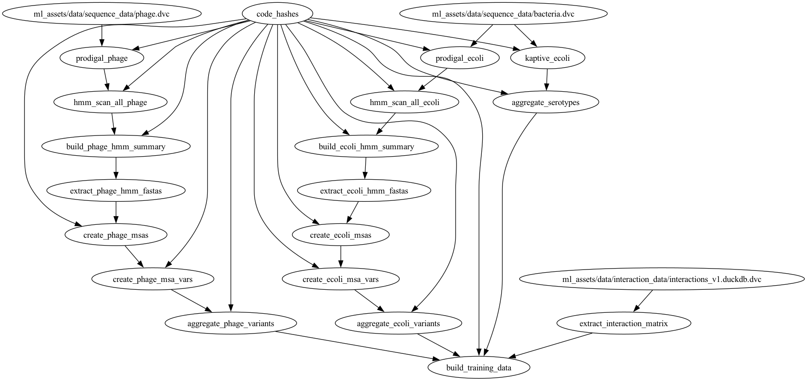

# 🧬 AlphaPhage Data Pipeline Architecture

This document describes the end-to-end orchestration of the AlphaPhage Transformer training data. The pipeline is managed by **DVC** to ensure reproducibility across genomic and phenotypic datasets.

---

## 🏗️ Core Architecture Overview

The pipeline follows a **Data Lake to Feature Store** pattern. Genomic sequences are processed into "shards" (Parquet), which are then aggregated into a central **DuckDB** feature store before being exported to **HDF5** for deep learning.

### 1. Data Intake & External Sources
* **Genomic Data**: Raw FASTA/GBK files are stored in `ml_assets/data/sequence_data/`.
* **Phenotypic Data**: Interaction labels are extracted from `ml_assets/data/interaction_data/interactions_v1.duckdb`.
* **Remote Storage**: All raw assets are backed up to [Google Drive](https://drive.google.com/drive/folders/1pZeochptPcfzRrc_n76bh0CG-4fjqlvX). Use `dvc pull` to retrieve them.

---

## 🛤️ Parallel Processing Streams

The pipeline splits into three primary streams to generate biological feature vectors:

### A. Phage & Host Variant Pipelines
* **Steps**: `prodigal` (Gene calling) ➔ `hmm_scan` (Domain detection) ➔ `create_msas` (Alignment) ➔ `create_msa_variants` (Clustering).
* **Output**: Distributed `.parquet` shards containing variant assignments for every HMM domain.
* **Aggregation**: The `aggregate_variants` stages collect these shards into the central `storage.feature_db`.

### B. Host Serotype Pipeline
* **Steps**: `kaptive_ecoli` ➔ `aggregate_serotypes`.
* **Output**: Specifically extracts K-type and O-type predictions for E. coli, providing critical surface-receptor features.

### C. Interaction Matrix Pipeline
* **Step**: `extract_interaction_matrix`.
* **Output**: A wide-format TSV (`Bacteria x Phage`) of ground-truth labels. It filters for "trusted" sources defined in `interactions_v1.0.0.yaml`.

---

## 🧪 Training Data Construction

### 6. Training Data Aggregation (`build_training_data`)
This is the "Join" stage where genomic features meet phenotypic labels.
* **Inputs**: DuckDB tables (Phage variants, Host variants, Serotypes) + Interaction TSV.
* **Transformation**: Joins all data on `organism_id`, handles missing data, and builds metadata arrays.
* **Result**: Paired HDF5 files (`x_*.h5` for features, `cl_*.h5` for labels) optimised for the AlphaPhage Transformer.

### 7. Model Training (`train_model`)
* Trains the Transformer architecture using the generated HDF5 datasets.
* Logs metrics and persists model checkpoints to `ml_assets/models/`.

---

## 🛠️ Developer Reference

| Action | Command |
| :--- | :--- |
| **View Full Graph** | `dvc dag` |
| **Run Pipeline** | `dvc repro` |
| **Check Dependencies** | `dvc status` |
| **Update Code Hashes** | Triggered automatically by the `code_hashes` stage |

> **Note**: This pipeline uses a custom orchestration layer to handle massive parallelism. If a worker fails, check the logs in `ml_assets/data/workflow/hashes/`.
